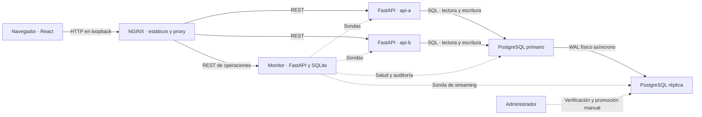
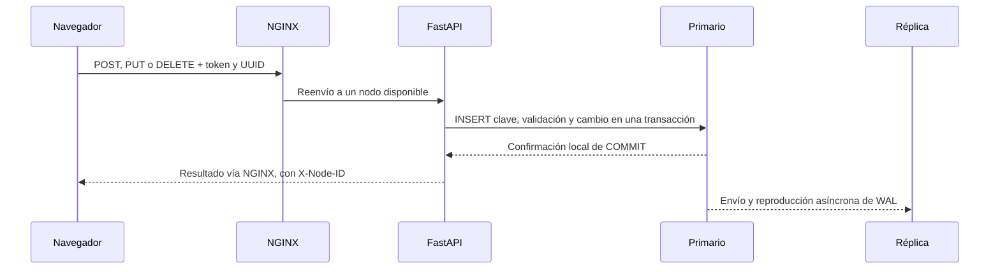

# Manual técnico · Vayxer

## Arquitectura



En Compose, `gateway` publica un único puerto en loopback. La red `edge` conecta al proxy con ambas APIs. La red interna `data` conecta las APIs y ambas instancias PostgreSQL, sin publicar puertos. Los nodos son independientes y sin estado local. El volumen de cada base conserva su propia copia.



El flujo indica que el API espera el commit local. La reproducción en la réplica puede ocurrir antes o después de la respuesta del cliente.

## API y consistencia

| Método | Ruta | Entrada y resultado |
|---|---|---|
| GET | `/api/live` | Vida del proceso, 200 |
| GET | `/api/ready` | Conexión al nodo escribible y esquema disponible, 200 o 503 |
| GET | `/api/orders` | `limit` de 1 a 100 y `offset`, por fecha de creación descendente e ID |
| GET | `/api/orders/{id}` | Consulta por UUID, 200 o 404 |
| POST | `/api/orders` | `customer`, `item`, `quantity`; 201 y estado inicial pendiente |
| PUT | `/api/orders/{id}` | Campos anteriores, `version` y `status`; 200 y versión nueva |
| DELETE | `/api/orders/{id}` | Cuerpo JSON con `version`; 200 con ID y confirmación |

Las rutas de pedidos exigen una sesión opaca entregada en cookie por HTTPS. Los clientes crean y consultan pedidos propios. La API filtra por identidad estable, devuelve 404 ante pedidos ajenos y reserva PUT/DELETE a administración (403 para clientes). GET /api/session informa el rol autenticado. GET /api/ops/summary exige administración y devuelve sondas e historial. Todas las mutaciones requieren un UUID en `Idempotency-Key`. Una repetición exitosa con el mismo método, pedido y cuerpo normalizado devuelve el resultado original. Reutilizar la clave con otra solicitud devuelve 409. Un error de validación devuelve 422. Los fallos de transacción revierten el cambio y la reserva de clave juntos.

PostgreSQL serializa las solicitudes con una misma clave mediante la restricción única. Para edición y borrado, `FOR UPDATE` serializa cambios en una fila y `version` rechaza escrituras basadas en una copia anterior. Los estados permiten conservar el actual o avanzar un paso: pendiente → en proceso → enviado → entregado. Las lecturas salen del primario para que una consulta posterior al commit vea el cambio.

El registro de idempotencia guarda respuestas exitosas cifradas. La clave UUID queda vinculada al método, recurso, cuerpo y cuenta. La auditoría de altas, ediciones, cambios de estado y borrados se escribe en la misma transacción y se replica. Guarda hora, acción, rol y estados, sin nombres, productos, identificadores de pedidos, tokens ni cuerpos.

## Roles, claves y cifrado

Las cuentas se crean con la herramienta interactiva indicada en el README, accesible a operadores con permisos de Docker. No hay autorregistro ni API para crear cuentas. `esteban_cliente` conserva el identificador interno `demo-alba` y `esteban_admin` conserva `admin`. Los pedidos con otro propietario conservan su asignación y siguen accesibles para administración. Cualquier otro usuario aprovisionado recibe el rol cliente.

Las contraseñas tienen de 12 a 128 caracteres. Cliente requiere letras y símbolos, administración números y símbolos. Se derivan con scrypt con sal aleatoria individual, N=32768, r=8 y p=3. SQLite almacena hashes, no contraseñas. El monitor genera sesiones aleatorias de 256 bits y almacena solo sus huellas SHA-256. Ambas APIs validan cada cookie con el monitor por la red interna. La cookie es HttpOnly, Secure y SameSite=Strict. Expira a las ocho horas por defecto y se revoca al cerrar sesión o cambiar la contraseña. Las mutaciones rechazan orígenes ajenos cuando el cliente envía Origin y las solicitudes de navegador marcadas como cross-site. En el perfil de demostración, tres contraseñas incorrectas consecutivas activan un bloqueo de cinco segundos para ese usuario y devuelven HTTP 429 con Retry-After. El intento durante el bloqueo no lo amplía. La racha se reinicia al iniciar sesión o tras cinco minutos sin fallar. El contador se asocia al nombre normalizado de cuenta, con la misma respuesta para usuarios existentes e inexistentes. Cambiar la cookie no reinicia la racha. Las sesiones legítimas ya abiertas continúan activas durante el bloqueo temporal. No se usa IP ni huella de dispositivo para bloquear. La capacidad se limita a dos derivaciones concurrentes y los contadores se comparten en SQLite.

Operaciones presenta «Actividad de acceso» y «Cuentas cliente». Solo administración puede bloquear o desbloquear clientes, con confirmación en la interfaz. El servidor reserva esa acción a administración y rechaza cualquier destino de rol administrador. Un bloqueo administrativo revoca todas las sesiones de la cuenta; desbloquear permite un nuevo inicio y conserva revocadas las sesiones anteriores. Las solicitudes que ya pasaron la autorización pueden terminar.

Los eventos guardan hora, acción, usuario y actor; excluyen contraseñas, cookies, tokens e IP. Registran fallos, inicio y cierre de sesión, bloqueo temporal y administrativo, cambios de cuenta y expiración observada al consultar una sesión. Se conservan hasta 5000 eventos y se muestran los 100 más recientes. El monitor y su volumen son una dependencia compartida de autenticación. Si PostgreSQL se detiene, administración aún puede iniciar sesión y consultar la salud. Si se pierde el monitor, las APIs rechazan las solicitudes protegidas hasta que vuelva. Protege y respalda su volumen; las claves Bearer anteriores quedan deshabilitadas y se pueden retirar de `.env`.

Cambiar la interfaz o declarar otro rol desde DevTools no cambia los permisos. Una sesión autorizada puede ver los datos que su rol recibe: cliente, sus propios pedidos; administración, todos los pedidos. HTTPS protege del navegador al gateway. El tráfico entre servicios sigue dentro de las redes de Docker y no usa TLS. No se almacenan sesiones en JavaScript ni credenciales en el repositorio.

Los campos cliente y producto y el resultado de las mutaciones se protegen con AES-256-GCM de Cryptography. Cada valor usa un nonce aleatorio de 96 bits. Los datos autenticados asociados vinculan el texto cifrado al pedido o a la solicitud y su cuenta. Las solicitudes nuevas usan una huella HMAC con una subclave separada. Los números de unidades, estados, fechas, identificadores de fila y de propietario se conservan en claro para las consultas. La clave está fuera del repositorio en `DATA_KEY` y debe conservarse junto con el plan de recuperación. Perderla impide leer los campos protegidos. El laboratorio emplea una clave para ambos nodos y no incluye rotación automática. Protege el host, el archivo `.env`, los respaldos y el acceso a Docker, que puede inspeccionar las variables de entorno. El cifrado no evita que una API comprometida con acceso a la clave lea datos.

### Migración de una instalación previa

1. Respalda el volumen y la configuración. Ejecuta `python deploy/setup.py --upgrade` para añadir las variables faltantes sin cambiar las claves existentes.
2. Detén las APIs anteriores. Ejecuta `docker compose exec -T primary psql -v ON_ERROR_STOP=1 -U postgres -d pedidos -f /opt/pedidos/02-security.sql`. Si el contenedor anterior no tiene ese archivo montado, usa `Get-Content -Raw database/02-security.sql | docker compose exec -T primary psql -v ON_ERROR_STOP=1 -U postgres -d pedidos` en PowerShell.
3. Compila la imagen y ejecuta `docker compose run --rm --no-deps api-a python encrypt_legacy.py`. El proceso cifra en lotes y puede repetirse. Después recrea las APIs, el monitor y el gateway con `docker compose up -d --build --wait`.
4. Los pedidos anteriores quedan visibles para administración. Para atribuir uno a un cliente, verifica primero la relación con evidencia externa y actualiza `owner_id` a su identificador estable en PostgreSQL. No infieras la propiedad por el nombre del comprador. Las huellas antiguas se conservan para respetar reintentos existentes. Copias previas, WAL y versiones de fila anteriores pueden conservar información histórica en claro.

### HTTPS local

El asistente de Windows genera un certificado local de 30 días si no existe. Para una instalación manual con OpenSSL, crea una carpeta `local-tls` y genera un certificado de laboratorio con SAN para el nombre y la dirección usados por el navegador:

```sh
mkdir local-tls
openssl req -x509 -newkey rsa:3072 -sha256 -days 30 -nodes -keyout local-tls/key.pem -out local-tls/cert.pem -subj "/CN=localhost" -addext "subjectAltName=DNS:localhost,IP:127.0.0.1"
docker compose -f compose.yaml -f tls.compose.yaml up -d --build --wait
curl --cacert local-tls/cert.pem https://127.0.0.1:8443/api/ready
```

Confía en el certificado de laboratorio en el cliente o usa un certificado emitido por una CA de confianza. El inicio de sesión requiere HTTPS. El override requiere Compose 2.24.4 o posterior y publica solo HTTPS en loopback. TLS protege del navegador al gateway. Las redes internas de Compose usan HTTP y PostgreSQL con SCRAM, sin TLS entre servicios.

## Tolerancia y diagnóstico

NGINX distribuye solicitudes entre dos destinos y reintenta ante errores de transporte y 502/503/504. En las mutaciones, los dos destinos comparten la misma tabla de idempotencia. Dos intentos agotan el presupuesto del proxy. La API registra nodo, ruta, código y duración, y NGINX registra tiempo total y destinos consultados. Los logs excluyen credenciales, cuerpos, parámetros y UUID de pedidos. El monitor sondea por separado gateway, vida y disponibilidad de ambas APIs, primario y recepción WAL de la réplica. Persiste solo las transiciones en SQLite sobre un volumen independiente. Un proceso vivo sin acceso a la base se marca degradado. El panel muestra la hora de la última sonda y consulta cada cinco segundos. La respuesta identifica al nodo final mediante `X-Node-ID`.

La réplica se inicia con `pg_basebackup -X stream -R`. Usa rol dedicado y autenticación SCRAM, configura 256 MB como mínimo de WAL reciente a conservar mediante wal_keep_size y recibe WAL continuamente. Si la desconexión supera el WAL disponible, se requiere otra copia base. La réplica se consulta para comprobar convergencia. El esquema y los registros de idempotencia también viajan por WAL.

- **Pérdida de un API.** El otro nodo puede atender el CRUD mientras NGINX y el primario estén disponibles. Puede haber demoras de reconexión y fallos de solicitudes si se agotan los intentos.
- **Pérdida de la réplica.** El primario sigue confirmando localmente. Se pierde la copia en línea durante el incidente.
- **Pérdida del primario.** El servicio devuelve 503 o un error de gateway durante el cambio manual. Puede perderse WAL confirmado localmente que aún no llegó a la réplica. El RPO depende del atraso y puede crecer con una desconexión. Una clave de idempotencia perdida queda sujeta al mismo límite.
- **Pérdida del gateway.** Las pantallas quedan inaccesibles. Si el monitor sigue activo, registra la caída y el retorno. Inspecciona `docker compose ps gateway` y `docker compose logs gateway`, corrige la causa y reinicia o recrea el gateway. Comprueba la portada y `/api/ready`.
- **Pérdida del monitor o del host.** Un fallo del monitor no detiene el CRUD. Reinícialo y conserva su volumen para consultar eventos previos. El sistema comparte un host y la réplica física tampoco sustituye un respaldo restaurable.

Para observar replicación, usa estas consultas desde el primario y la réplica, respectivamente:

```sql
SELECT application_name, state, sync_state,
       pg_wal_lsn_diff(pg_current_wal_lsn(), replay_lsn) AS atraso_bytes
FROM pg_stat_replication;
SELECT pg_is_in_recovery(), pg_last_wal_receive_lsn(), pg_last_wal_replay_lsn();
```

## Recuperación manual del primario en Compose

Usa un laboratorio desechable para ensayar. En una caída real, anota la hora, confirma la recuperación de WAL disponible y evalúa posible pérdida antes de aceptar nuevas escrituras. Nunca promociones mientras el primario anterior pueda aceptar escrituras.

1. Detén el primario con `docker compose stop primary`. Comprueba con `docker compose ps -a primary` que esté detenido. Si la interrupción es de red, aísla el servidor del tráfico y verifica el aislamiento por otro canal antes de avanzar. Suspende cualquier proceso que pudiera volver a iniciarlo.
2. Confirma que la réplica sigue en recuperación y revisa las posiciones recibida y reproducida. Cuando la reproducción haya alcanzado el WAL disponible, promueve:

   ```sh
   docker compose exec -T replica psql -U postgres -d pedidos -v ON_ERROR_STOP=1 -c "SELECT pg_promote(true, 60);"
   docker compose exec -T replica psql -U postgres -d pedidos -Atc "SELECT pg_is_in_recovery();"
   ```

   El primer comando debe indicar que la promoción se completó. El segundo debe devolver `f`.

3. En `.env`, cambia `DB_HOST=primary` por `DB_HOST=replica` y configura `REPLICA_HOST=replacement` y quita de la terminal cualquier variable `DB_HOST` que tenga prioridad. Recrea las APIs y el monitor.

   ```sh
   docker compose up -d --no-deps --force-recreate api-a api-b monitor
   curl --cacert local-tls/cert.pem https://127.0.0.1:8443/api/ready
   ```

4. Lee un pedido anterior y comprueba una mutación controlada. Anota RTO y concilia pedidos cuyo resultado era incierto con los clientes. Mantén detenido el primario anterior y conserva su volumen para diagnóstico o conciliación.
5. Incorpora una copia nueva con un volumen independiente y la réplica promovida como origen.

   ```sh
   docker compose -f compose.yaml -f recovery.compose.yaml up -d --no-deps replacement
   docker compose -f compose.yaml -f recovery.compose.yaml exec -T replacement psql -U postgres -d pedidos -c "SELECT pg_is_in_recovery(), status FROM pg_stat_wal_receiver"
   ```

   Espera `t` y `streaming`. Comprueba convergencia con otra escritura controlada. En la topología recuperada, inicia solo `gateway replica replacement api-a api-b monitor` con ambos manifiestos y `DB_HOST=replica`. Evita el arranque global del manifiesto base durante la recuperación. La copia antigua puede archivarse según el procedimiento del equipo.

## Decisiones

| Decisión | Motivo y costo |
|---|---|
| ADR-01 · Dos APIs sin estado | Aislar la caída de un proceso y permitir cambio de destino. La BD centraliza coordinación. |
| ADR-02 · WAL asíncrono y promoción manual | Permite que la réplica se ausente sin bloquear al primario. Acepta posible pérdida de escrituras y un intervalo de indisponibilidad al promover. |
| ADR-03 · Idempotencia transaccional y versión por fila | Evitar duplicados por reintentos y actualizaciones perdidas. El registro crece con cada mutación exitosa. |
| ADR-04 · REST, sondas periódicas y claves individuales | Cubrir el flujo con pocos componentes. El monitor observa salud periódicamente y las listas de pedidos se actualizan al consultar o guardar. |

Fuentes técnicas oficiales. [PostgreSQL 16 · Streaming replication y promoción](https://www.postgresql.org/docs/16/warm-standby.html) · [PostgreSQL 16 · pg_basebackup](https://www.postgresql.org/docs/16/app-pgbasebackup.html) · [NGINX · proxy_next_upstream](https://nginx.org/en/docs/http/ngx_http_proxy_module.html#proxy_next_upstream)

[Guía OWASP de almacenamiento de contraseñas](https://cheatsheetseries.owasp.org/cheatsheets/Password_Storage_Cheat_Sheet.html)

## Capacidad y límites pendientes

Las dos APIs siguen sin estado local y permiten atender la pérdida de un proceso de aplicación. Las consultas de pedidos están paginadas, las tablas tienen índices por fecha y propietario, y las vistas de eventos muestran cantidades acotadas. Los paneles largos usan desplazamiento interno y las acciones se adaptan al ancho disponible.

El gateway, el primario escribible y el monitor de autenticación continúan siendo componentes compartidos. SQLite serializa las escrituras de sesiones y eventos. Para una carga mayor se requieren mediciones y una evolución del servicio de autenticación y su almacenamiento, además de paginación del catálogo de cuentas y respaldo verificable. Las pruebas locales de latencia no constituyen una estimación de capacidad máxima. El límite por cuenta no cubre por sí solo un ataque sostenido sobre muchos nombres diferentes.
